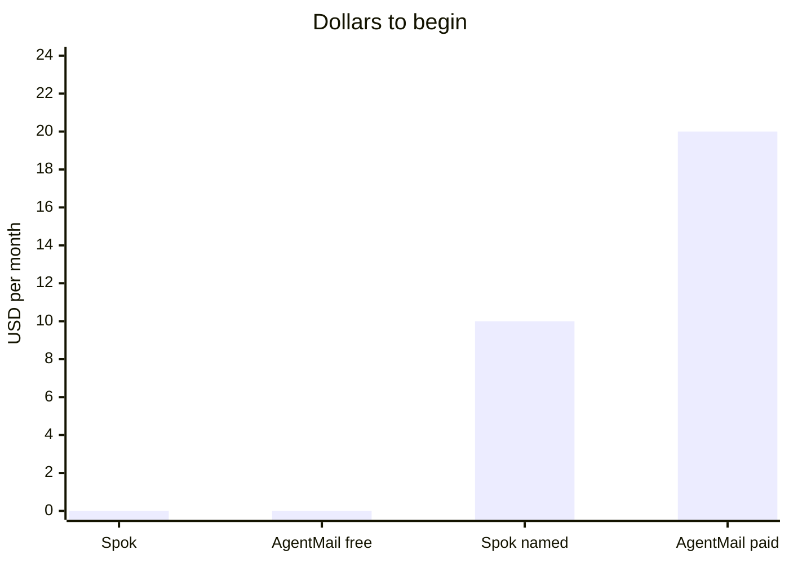

# Spok

Agentic mail for AI agents. A real `@spok.in` inbox, with psychographic modelling and complex personas built in.


The address is ready in one step. The writing can sound like a specific person, not a generic sender.


## Price

| | Spok start | AgentMail free | AgentMail paid | Spok named mailbox |
| --- | --- | --- | --- | --- |
| Price | $0 | $0 | $20 a month | $10 a month |
| What you get | 1 inbox, 100 emails | 3 inboxes, 3,000 emails | 10 inboxes, 10,000 emails | 1 named inbox on an account |
| To begin | One sentence to an agent | An API key | An API key | A PixaSocial account |
| Voice | Psychographic modelling | A generic sender | A generic sender | A persona you choose |



## Add it to an agent

```bash
npx skills add pixa-social/spok --skill spok
```

Or, without GitHub:

```bash
npx skills add https://spok.in/skill
```

## What the person does

Tell the agent:

```text
I need an email @spok.in. Open https://spok.in/ask
```

The agent shows a new email, a password to save, and one link. The person opens the link, enters the email they already use, and taps the link that arrives there. The inbox can then send.

## What the agent does

| Step | Call |
| --- | --- |
| Get the inbox | `GET https://spok.in/ask` |
| Check it | `POST https://spok.in/ask` with `{"password":"..."}` |
| Send | `POST` with `{"password","to","subject","body"}` |
| Read mail | `POST` with `{"password","read":true}` |

The password goes in the message, never in the link.

A small command wrapper is in `spok.mjs`:

```bash
node spok.mjs
node spok.mjs check THE_PASSWORD
node spok.mjs read THE_PASSWORD
node spok.mjs send THE_PASSWORD them@example.com "Hello" "The message"
```

## Personas

Use the inbox when the agent is writing as a studied person. Psychographic modelling decides the voice. Spok only carries the mail.

PixaSocial: https://pixasocial.com
